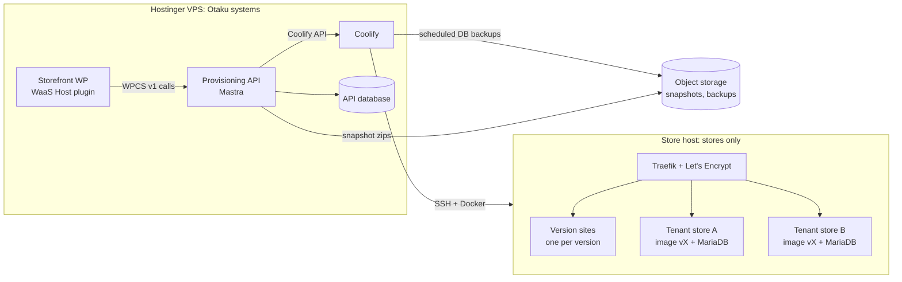

# Hosting

Where the peptide stores run, and how the API builds them. Research date: 2026-10-07. Issue: `waas-api-2hl.3`.

## Constraint

Hostinger's terms rule out the stores on Otaku's Hostinger VPS (clause quoted under [Providers](#providers)). That VPS runs Coolify, the storefront, the provisioning API and the agents. None of those sell anything, so they stay there.

Rules for the store host:

1. The provider accepts the stores **in writing**, before the first store goes live. A host that says nothing about the content is not acceptance.
2. Store servers never run Otaku's own systems, and Otaku's servers never run stores.
3. Every provider in a store's request and data path needs the same check, not only the server: object storage for backups, DNS and registrar, any CDN or proxy, the email relay, and the payment processor.

A host's acceptance covers its own terms only. It does not change the stores' legal position with the FDA or the states (see "Compliance landscape" in the vault note *Peptide WaaS and Audits*).

## Layout

- Coolify manages the store server as a remote server over SSH (`POST /api/v1/servers`, then `/validate`). Store containers, store databases and store files exist only on the store server and in store-side object storage.
- What the Hostinger side holds about a store: the API's records (ids, names, domains, status, version), the Coolify resource definitions, and the environment values Coolify passes to containers (`phpConstants`, the WP user's initial password until first boot). No catalog, orders or customer data.
- The store host gets its own Coolify project and its own SSH key. Nothing from Otaku's projects is deployed to it.

## Per-store architecture

### Version = container image

One image per template version, built in CI and pushed to a private registry:

| Layer | Contents |
|---|---|
| Base | Official `wordpress:<wp>-php<php>-apache`, pinned by digest. `wordPressVersion` and `phpVersion` from `createVersion` pick the tag. |
| Plugins | FluentCart, FluentCRM, FluentAuth, FluentSnippets, FluentSMTP, WaaS Client (`waas-client` + `waas-client-data/roles.json`) |
| Compliance code | FluentSnippets files in `wp-content/fluent-snippet-storage` (attestation checkbox, age gate, disclaimer injection), from git |
| Lockdown | `DISALLOW_FILE_MODS` and `AUTOMATIC_UPDATER_DISABLED` defined, so a tenant cannot add or update plugins |
| Entrypoint | `waas-bootstrap`: on start, runs WP-CLI to install or upgrade the database, apply `wpOptions`, and create the WordPress user. Idempotent; it re-runs when the config hash changes. |

Code is read-only in the container. `wp-content/uploads` is the only writable path, on a per-tenant volume.

Each version also runs one **version site** from the same image, at `v-<versionId>.<store base domain>`. It is WPCS's "Version Editor": the place to set up the template's content. The version site of the production version is the "production version domain" that serves `roles.json` at `/wp-content/plugins/waas-client-data/roles.json`.

### Tenant = one app + one database

| Piece | Coolify resource |
|---|---|
| WordPress | Application from a Docker image (`POST /api/v1/applications/dockerimage`), image tag = the tenant's version, `domains` = the tenant's domains, health check on `/` |
| Database | Its own MariaDB (`POST /api/v1/databases/mariadb`) on the same server, with a scheduled backup to object storage |
| Uploads | Persistent volume (`POST /api/v1/applications/{uuid}/storages`) |
| Settings | Application env vars (`PATCH /api/v1/applications/{uuid}/envs/bulk`) |

A MariaDB container per store keeps each store's data, backup and restore separate, and Coolify's API creates and backs it up without extra code. Each costs roughly 100–200 MB of RAM. Past about 50 stores on one server, move to one MariaDB server per store server with a database and user per store.

How the provisioning requirements from the README map onto this:

| Requirement | Implementation |
|---|---|
| `WPCS_IS_TENANT=true` visible to PHP | Container env var. Apache passes it through, so `getenv()` sees it. Confirm which accessor the Client plugin uses (`getenv`, `$_ENV` or `$_SERVER`). |
| `phpConstants` written with `define()` | `WORDPRESS_CONFIG_EXTRA` env var. The official image's `wp-config.php` evaluates it before WordPress loads. The API renders one `define('NAME', 'value');` per entry, with values escaped. |
| `wpOptions` applied | `waas-bootstrap` runs `wp option update` for each entry |
| User created with the requested role | `waas-bootstrap` runs `wp user create` once |
| WaaS Client active | Baked into the image; activated by `waas-bootstrap` |
| `HEAD https://{domain}` → 200, no redirect | `home` and `siteurl` follow the main domain. Coolify's `redirect` setting stays off for the main domain. Redirect domains get a 301 at the proxy. |
| `/wp-json/waas-client/v1/single_login/verify` anonymous | No basic auth or WAF rule on `/wp-json/` |

The Coolify API has no "run a command in a container" endpoint. That is why options and the user are applied by the entrypoint rather than by the API.

### Snapshot = database dump + uploads

A snapshot is a zip in object storage: a `mysqldump` of the store database plus `wp-content/uploads`, with a manifest naming the version it was taken on. Code is not in it, because the version image carries the code.

- **Base snapshots** (`isTenantSnapshot: false`) come from a version site, for example "Peptide store, demo catalog". Their `groupName` is what the storefront offers per product.
- **Tenant snapshots** (`isTenantSnapshot: true`) come from a live store.
- `downloadSnapshot` streams the zip.

## API mapping

The API keeps its own database of versions, snapshots and tenants, and stores the Coolify UUIDs for each. `statusCode` follows the asynchronous job: 0 Pending while Coolify deploys, 1 Done once the health check and `HEAD https://{domain}` both pass, 2 Failed, 3 Removing.

| Operation | What happens on the store host |
|---|---|
| `createVersion` | Build or select the image for `wordPressVersion`/`phpVersion`, start the version site, import `snapshotId` into it. `useCustomUpload`: build the image from the uploaded `wp-content`. Returns the version site domain. |
| `setProductionVersion` | Flag in the API database. The storefront then reads `roles.json` from that version's site. |
| `deleteVersion` | Refused while it is production or has tenants; otherwise remove the version site. |
| `listSnapshots` / `downloadSnapshot` | API database / object storage |
| `createTenant` | Create the MariaDB, restore the chosen snapshot into it, create the app on the version's image with env vars and `domains = baseDomain[,customDomain]`, deploy. `externalId` generated if absent. |
| `updateTenantOptionsAndConstants` | Update env vars, redeploy. `waas-bootstrap` applies the change. |
| `moveTenantToAVersion` | Change the app's image tag, redeploy. `waas-bootstrap` runs `wp core update-db`. The database stays. |
| `addTenantDomain` / `removeTenantDomain` | Update the app's `domains`; Traefik requests or drops the certificate. |
| `setMainDomain` | Update `home`/`siteurl` and move the other domains to redirects. |
| `checkDomainAvailability` | API database lookup for the base domain |
| `deleteTenant` | Final backup, then delete the app, the database and the volume. |

### Domains and SSL

- Base domains are `<slug>.<store base domain>`. The store base domain is a separate registered domain, not a subdomain of an Otaku domain, with a wildcard `A` record to the store server.
- Certificates come from Let's Encrypt through Coolify's Traefik, one per hostname (HTTP-01). Custom domains point a `CNAME` or `A` record at the store server first; the API checks DNS before it adds the domain, so a failed challenge does not burn the rate limit.
- Let's Encrypt's limit is 50 certificates per registered domain per week. Past that, switch the base domain to one wildcard certificate (DNS-01, which needs a DNS provider API in Traefik).

PROVIDERS_PLACEHOLDER
