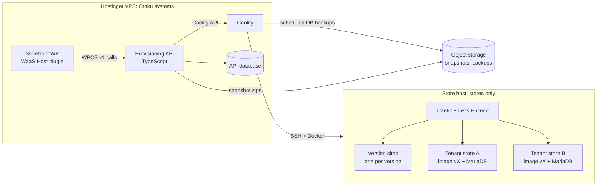

# Hosting

Where the peptide stores run, and how the API builds them. Research date: 2026-10-07. Issue: `waas-api-2hl.3`.

## Constraint

Hostinger's terms rule out the stores on Otaku's Hostinger VPS (clause quoted under [Providers](#providers)). That VPS runs Coolify, the storefront, the provisioning API and the agents. None of those sell anything, so they stay there.

Rules for the store host:

1. The provider accepts the stores **in writing**, before the first store goes live. A host that says nothing about the content is not acceptance.
2. Store servers never run Otaku's own systems, and Otaku's servers never run stores.
3. Every provider in a store's request and data path needs the same check, not only the server: object storage for backups, DNS and registrar, any CDN or proxy, the email relay, and the payment processor.

A host's acceptance covers its own terms only. It does not change the stores' legal position with the FDA or the states (see "Compliance landscape" in the vault note *Peptide WaaS and Audits*).

## Layout

- Coolify manages the store server as a remote server over SSH (`POST /api/v1/servers`, then `/validate`). Store containers, store databases and store files exist only on the store server and in store-side object storage.
- What the Hostinger side holds about a store: the API's records (ids, names, domains, status, version), the Coolify resource definitions, and the environment values Coolify passes to containers (`phpConstants`, the WP user's initial password until first boot). No catalog, orders or customer data.
- The store host gets its own Coolify project and its own SSH key. Nothing from Otaku's projects is deployed to it.

## Per-store architecture

### Version = container image

One image per template version, built in CI and pushed to a private registry:

| Layer | Contents |
|---|---|
| Base | Official `wordpress:<wp>-php<php>-apache`, pinned by digest. `wordPressVersion` and `phpVersion` from `createVersion` pick the tag. |
| Plugins | FluentCart, FluentCRM, FluentAuth, FluentSnippets, FluentSMTP, WaaS Client (`waas-client` + `waas-client-data/roles.json`) |
| Compliance code | FluentSnippets files in `wp-content/fluent-snippet-storage` (attestation checkbox, age gate, disclaimer injection), from git |
| Lockdown | `DISALLOW_FILE_MODS` and `AUTOMATIC_UPDATER_DISABLED` defined, so a tenant cannot add or update plugins |
| Entrypoint | `waas-bootstrap`: on start, runs WP-CLI to install or upgrade the database, apply `wpOptions`, and create the WordPress user. Idempotent; it re-runs when the config hash changes. |

Code is read-only in the container. `wp-content/uploads` is the only writable path, on a per-tenant volume.

Each version also runs one **version site** from the same image, at `v-<versionId>.<store base domain>`. It is WPCS's "Version Editor": the place to set up the template's content. The version site of the production version is the "production version domain" that serves `roles.json` at `/wp-content/plugins/waas-client-data/roles.json`.

### Tenant = one app + one database

| Piece | Coolify resource |
|---|---|
| WordPress | Application from a Docker image (`POST /api/v1/applications/dockerimage`), image tag = the tenant's version, `domains` = the tenant's domains, health check on `/` |
| Database | Its own MariaDB (`POST /api/v1/databases/mariadb`) on the same server, with a scheduled backup to object storage |
| Uploads | Persistent volume (`POST /api/v1/applications/{uuid}/storages`) |
| Settings | Application env vars (`PATCH /api/v1/applications/{uuid}/envs/bulk`) |

A MariaDB container per store keeps each store's data, backup and restore separate, and Coolify's API creates and backs it up without extra code. Each costs roughly 100–200 MB of RAM. Past about 50 stores on one server, move to one MariaDB server per store server with a database and user per store.

How the provisioning requirements from the README map onto this:

| Requirement | Implementation |
|---|---|
| `WPCS_IS_TENANT=true` visible to PHP | Container env var. Apache passes it through, so `getenv()` sees it. Confirm which accessor the Client plugin uses (`getenv`, `$_ENV` or `$_SERVER`). |
| `phpConstants` written with `define()` | `WORDPRESS_CONFIG_EXTRA` env var. The official image's `wp-config.php` evaluates it before WordPress loads. The API renders one `define('NAME', 'value');` per entry, with values escaped. |
| `wpOptions` applied | `waas-bootstrap` runs `wp option update` for each entry |
| User created with the requested role | `waas-bootstrap` runs `wp user create` once |
| WaaS Client active | Baked into the image; activated by `waas-bootstrap` |
| `HEAD https://{domain}` → 200, no redirect | `home` and `siteurl` follow the main domain. Coolify's `redirect` setting stays off for the main domain. Redirect domains get a 301 at the proxy. |
| `/wp-json/waas-client/v1/single_login/verify` anonymous | No basic auth or WAF rule on `/wp-json/` |

The Coolify API has no "run a command in a container" endpoint. That is why options and the user are applied by the entrypoint rather than by the API.

### Snapshot = database dump + uploads

A snapshot is a zip in object storage: a `mysqldump` of the store database plus `wp-content/uploads`, with a manifest naming the version it was taken on. Code is not in it, because the version image carries the code.

- **Base snapshots** (`isTenantSnapshot: false`) come from a version site, for example "Peptide store, demo catalog". Their `groupName` is what the storefront offers per product.
- **Tenant snapshots** (`isTenantSnapshot: true`) come from a live store.
- `downloadSnapshot` streams the zip.

## API mapping

The API keeps its own database of versions, snapshots and tenants, and stores the Coolify UUIDs for each. `statusCode` follows the asynchronous job: 0 Pending while Coolify deploys, 1 Done once the health check and `HEAD https://{domain}` both pass, 2 Failed, 3 Removing.

| Operation | What happens on the store host |
|---|---|
| `createVersion` | Build or select the image for `wordPressVersion`/`phpVersion`, start the version site, import `snapshotId` into it. `useCustomUpload`: build the image from the uploaded `wp-content`. Returns the version site domain. |
| `setProductionVersion` | Flag in the API database. The storefront then reads `roles.json` from that version's site. |
| `deleteVersion` | Refused while it is production or has tenants; otherwise remove the version site. |
| `listSnapshots` / `downloadSnapshot` | API database / object storage |
| `createTenant` | Create the MariaDB, restore the chosen snapshot into it, create the app on the version's image with env vars and `domains = baseDomain[,customDomain]`, deploy. `externalId` generated if absent. |
| `updateTenantOptionsAndConstants` | Update env vars, redeploy. `waas-bootstrap` applies the change. |
| `moveTenantToAVersion` | Change the app's image tag, redeploy. `waas-bootstrap` runs `wp core update-db`. The database stays. |
| `addTenantDomain` / `removeTenantDomain` | Update the app's `domains`; Traefik requests or drops the certificate. |
| `setMainDomain` | Update `home`/`siteurl` and move the other domains to redirects. |
| `checkDomainAvailability` | API database lookup for the base domain |
| `deleteTenant` | Final backup, then delete the app, the database and the volume. |

### Domains and SSL

- Base domains are `<slug>.<store base domain>`. The store base domain is a separate registered domain, not a subdomain of an Otaku domain, with a wildcard `A` record to the store server.
- Certificates come from Let's Encrypt through Coolify's Traefik, one per hostname (HTTP-01). Custom domains point a `CNAME` or `A` record at the store server first; the API checks DNS before it adds the domain, so a failed challenge does not burn the rate limit.
- Let's Encrypt's limit is 50 certificates per registered domain per week. Past that, switch the base domain to one wildcard certificate (DNS-01, which needs a DNS provider API in Traefik).

## Providers

Terms read on 2026-10-07. Each quote is verbatim from the URL beside it. **Prohibited** means a clause names prescription drugs or controlled substances. **Silent** means the terms only require lawful use. **Allowed** means written acceptance; no provider checked has it.

A "silent" result does not clear a store. Every provider below bans illegal use, and the vault research ("Compliance landscape") records that the FDA treats peptides sold for human use as unapproved drugs whatever the "research use only" label says. Each provider can also suspend at its own discretion or after an abuse report.

### VPS and cloud (Coolify-managed)

| Provider | Class | Operative clause | Law | Source |
|---|---|---|---|---|
| Hostinger | **Prohibited** | "promotes, encourages or engages in the (i) sale or distribution of prescription medication without a valid prescription and (or) license" (§6.4). Also: "For notices from trusted flaggers indicating Illegal Content within the Services, automated systems will initiate immediate Services suspension." | Luxembourg | [Universal ToS](https://www.hostinger.com/legal/universal-terms-of-service-agreement), last revised 2026-09-29 |
| DigitalOcean | **Prohibited** | "Unlawfully selling or distributing controlled substances, including but not limited to any illegal or prescription drugs." | n/a in AUP | [AUP](https://www.digitalocean.com/legal/acceptable-use-policy), 2026-03-20 |
| UpCloud | Silent (illegal products named) | "Sale or promotion of illegal material, substances or products." Also: "If you are uncertain whether or not your intended use of the Service could be deemed illegal, offensive or disruptive, you can contact UpCloud in advance and request permission" | Finland | [ToS + AUP](https://upcloud.com/global/terms-of-service/), effective 2026-07-03 |
| Hetzner | Silent | "The Customer is obligated not to publish any content that infringes on the rights of third parties or otherwise violates applicable law." (§8.2). US terms §4: content may not "violate the federal or any state law of the US." | Germany | [Terms](https://www.hetzner.com/legal/terms-and-conditions/), 2021-10-27 |
| Contabo | Silent | Content must "not contravene German law or any potentially deviating laws of the country in which the customer's registered seat is located" (clause 6(1)) | Germany | [Terms](https://contabo.com/en/legal/terms-and-conditions/), Dec 2025 |
| Scaleway | Silent | "undertakes not to use the Services in a manner or for purposes that are unlawful, improper, or prohibited by the Contract or applicable regulations." (§8.1); suspension "without prior notice" on "Reporting of illicit Content" (art. 11) | France | [GTS PDF](https://www-uploads.scaleway.com/Conditions_Generales_de_Services_v2026_a0028de41c.pdf), 2026-04-07 |
| Vultr | Silent | "You may not use ... the Services for any illegal, criminal, unlawful, harmful, fraudulent, infringing or offensive use or enterprise" (AUP §1); "WE COOPERATE WITH LAW ENFORCEMENT AND REPORT SUSPICIOUS AND/OR ILLEGAL ACTIVITY" | New Jersey | [AUP](https://www.vultr.com/legal/use-policy/), 2026-03-11 |
| Akamai / Linode | Silent | "to participate in or support any illegal activity in a relevant jurisdiction, including activity that can cause death, serious harm, or injury to individuals or groups of individuals" | n/a in AUP | [AUP PDF](https://www.akamai.com/site/en/documents/corporate/acceptable-use-policy.pdf), effective 2026-08-01 |
| OVHcloud (US) | Silent | Content may not "(i) ... create a risk of harm, loss, physical or mental injury ... or physical or mental illness to anyone; ... (iii) ... constitute or contribute to a crime or tort" | Virginia | [ToS](https://us.ovhcloud.com/legal/terms-of-service/), 2025-05-15 |
| AWS | Silent | "for any illegal or fraudulent activity" | n/a in AUP | [AUP](https://aws.amazon.com/aup/), 2021-07-01 |

### Managed WordPress

| Provider | Class | Operative clause | Source |
|---|---|---|---|
| Cloudways | **Prohibited** | Its AUP link points to DigitalOcean's AUP ("illegal or prescription drugs", above) | [Terms](https://www.cloudways.com/en/terms.php) |
| Pressable | **Prohibited** | "must not ... sell any items that are prohibited, fraudulent, abusive, hazardous, or illegal"; listed items include "Controlled substances, including kratom"; "interpretations are solely up to us" | [Site guidelines](https://pressable.com/legal/site-guidelines/) |
| Kinsta | Silent, pre-approval path | "If you have a query about hosting any website or content related to cannabis (including Marijuana, Hemp, CBD, & THC) or other regulated substances, please contact our Support team." | [Prohibited content](https://kinsta.com/docs/service-information/prohibited-content/) |
| WP Engine | Silent | "you may not use the Services in connection with any content that we reasonably believe: … constitutes terrorism or trafficking in weapons or other illegal items" | [AUP](https://wpengine.com/legal/aup/) |
| Rocket.net | Silent | "in violation of any local, state, federal, or non-United States law or regulation" | [ToS](https://rocket.net/terms-of-service/) |
| Nexcess / Liquid Web | Silent | "you shall not use the Services for activities which, in our sole discretion, may be illegal ... or that would expose us to criminal or civil liability." | [AUP](https://www.nexcess.com/policies/acceptable-use-policy/), 2025-12-08 |
| Pantheon | Silent | "Comply with all applicable laws, including ... regulatory requirements" | [Legal](https://legal.pantheon.io/), AUP v5.0 |
| InstaWP | Silent (no content clause) | Only a general "contrary to law or regulation" disclaimer; the underlying cloud's AUP applies and is not named | [Terms](https://instawp.com/legal/terms/) |

Not read (the fetch budget ran out): SiteGround, 20i, GridPane, SpinupWP, RunCloud, xCloud, Cloudflare. GridPane, SpinupWP, RunCloud and xCloud run on a VPS you rent, so that VPS provider's terms apply as well (DigitalOcean's ban covers any of them on a droplet).

Managed hosts also don't fit the architecture above. They provision their own WordPress stack rather than running our version image, so versions, snapshots and `phpConstants` would be rebuilt on each host's API. Coolify on a VPS keeps one implementation.

High-risk and offshore hosts were not researched. Choosing a host because it resists takedowns or applies another country's law does not meet rule 1, which asks for open written acceptance.

### Result

No mainstream provider accepts these stores as described, and the obstacle sits upstream of hosting. Two providers ban prescription-drug sales outright, and the rest ban unlawful sales, which the FDA's position makes these. A written yes is realistic only once the stores operate in a form that is lawful where they sell. Some examples:

- research-use-only sales restricted to verified institutions, with the audit's attestation and business checks enforced at checkout
- products that are lawful to sell to consumers
- a licensed pharmacy or telehealth partner that holds the prescription

The architecture above is provider-neutral and applies once that is settled.

### What needs a written answer from a provider

Ask once the selling model is fixed. The candidates whose terms invite the question are UpCloud ("contact UpCloud in advance and request permission") and Kinsta (support pre-approval for "regulated substances"); Hetzner and Contabo are the plain-VPS options to ask under German law.

1. Do you accept, in writing, stores that sell [the exact products and buyer restrictions], to customers in [countries]? Name the clause the acceptance relies on.
2. Is the acceptance tied to our account, so it survives an abuse report or a trusted-flagger notice? What happens on a complaint: notice and time to respond, or immediate suspension?
3. Does it cover every product the stores use: servers, block volumes, object storage (snapshots and backups), backup service and the network?
4. May we run many client stores (multi-tenant, one database each) on one account, with clients as the merchants of record?
5. Server location for US customers, and whether data stays in that region.

The same written check applies to the other providers in a store's path: object storage, DNS and registrar, CDN or proxy, the email relay (FluentSMTP to SES puts AWS's AUP in the path), and the payment processor.
